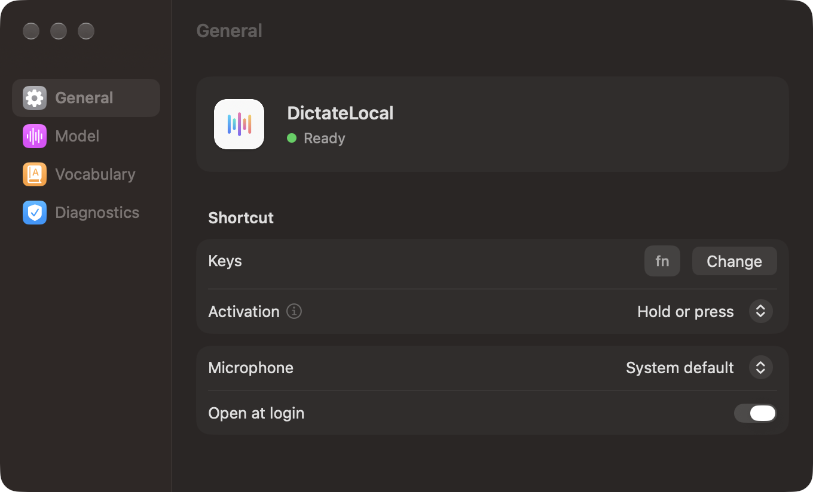
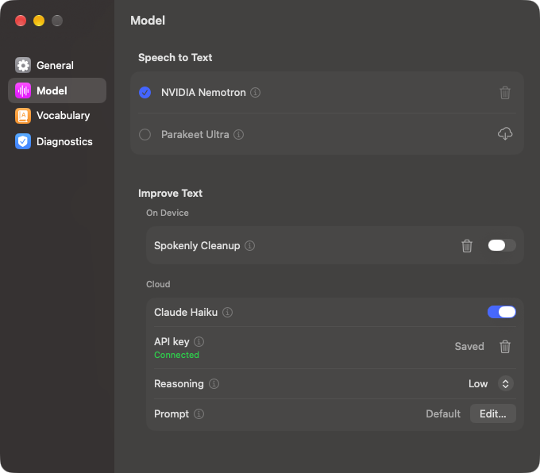

# DictateLocal

[](https://github.com/merkLui/DictateLocal/actions/workflows/ci.yml)
[](LICENSE)


Dictation for the Mac that runs on the Mac. Hold a key, speak, and the text appears wherever your cursor is: in Slack, a browser, your editor or a terminal. Speech is recognized on your Mac, so it works offline, costs nothing and never uploads your voice.

It was built for people who mix languages, such as German with English tech terms ("Kannst du den Pull Request mergen?"), and it handles that well.

<p align="center">
  
  
</p>

## Features

- **Types while you speak.** With NVIDIA Nemotron the text appears at the cursor about two seconds behind your voice. Parakeet Ultra instead inserts everything at once when you stop.
- **Works in any app.** Text is typed into the focused field, including in Chromium-based browsers; outside a text field it is pasted or offered for copying.
- **Your shortcut.** A single key such as `fn` or a function key, or a combination with a modifier. Hold to talk, tap to start and stop, or both.
- **Optional cleanup.** Remove filler words on the Mac with Spokenly Cleanup, or let Claude Haiku fix misheard words and format lists, with your own Anthropic API key.
- **Vocabulary.** Fix words the model keeps getting wrong, such as "Cloud Code → Claude Code".
- **Light.** Only the selected model is in memory: about 110 MB with Nemotron.

## Requirements

- A Mac with Apple Silicon (M1 or later)
- macOS 26 or later
- About 600 MB of disk space for a speech model, which downloads on first launch

## Install

### Homebrew

```bash
brew install --cask merkLui/tap/dictatelocal
```

### Download

1. Download `DictateLocal-<version>.dmg` from the [latest release](https://github.com/merkLui/DictateLocal/releases/latest).
2. Open it and drag DictateLocal onto the Applications folder.
3. Open DictateLocal from Applications. macOS will say it cannot verify the developer, because DictateLocal is not notarized by Apple (see [FAQ](#why-does-macos-say-it-cannot-verify-the-app)). Open **System Settings > Privacy & Security** and click **Open Anyway**. This is needed once.

### Build from source

Needs the Xcode Command Line Tools (`xcode-select --install`) or Xcode 26.

```bash
git clone https://github.com/merkLui/DictateLocal.git
cd DictateLocal
scripts/build-app.sh
cp -R dist/DictateLocal.app /Applications/
```

## Getting started

1. Open DictateLocal. It lives in the menu bar and downloads the speech model in the background.
2. Grant the permissions it asks for under **Settings > Diagnostics**.
3. Hold `fn` and speak. Release to finish.

| Permission | Why DictateLocal needs it |
| --- | --- |
| Microphone | To record your voice. The audio never leaves your Mac. |
| Input Monitoring | To notice the shortcut in every app. |
| Accessibility | To type and paste the text into the app you are using. |

## Speech models and text improvement

Choose under **Settings > Model**. Every option has an info button with details.

| | Runs | What it does | Disk | Memory |
| --- | --- | --- | --- | --- |
| **NVIDIA Nemotron** (default) | On your Mac | Streams: types while you speak | 590 MB | about 110 MB |
| **Parakeet Ultra** | On your Mac | Inserts the whole text when you stop | about 600 MB | about 150 MB |
| **Spokenly Cleanup** | On your Mac | Removes filler words, adds punctuation | 331 MB | about 450 MB while in use |
| **Format lists** | On your Mac | Turns dictated enumerations into bullet points, by fixed rules | none | none |
| **Claude Haiku** | Anthropic's servers | Fixes misheard words and filler words, formats lists | none | none |

Claude Haiku needs an [Anthropic API key](https://console.anthropic.com/) and costs about 0.01 cents per dictation on your account. You can choose how much it reasons and edit its prompt. If the answer does not look like a cleaned version of what you said, or there is no network, DictateLocal keeps your text as dictated.

## Privacy

- Speech recognition always runs on your Mac. Audio is never stored or uploaded.
- Spokenly Cleanup and list formatting also run on your Mac.
- Only if you turn on Claude Haiku is the recognized text, not the audio, sent to Anthropic with your key. The key is stored in `~/Library/Application Support/DictateLocal/anthropic-api-key`, readable only by your user account.
- A local log helps with troubleshooting. Turn on **Hide dictated text in log** under Diagnostics to keep your words out of it. The log stays on your Mac unless you export it.
- DictateLocal has no analytics and no telemetry. Its only network requests are model downloads from Hugging Face and, if enabled, the Anthropic API.

## FAQ

### Why does macOS say it cannot verify the app?

Apple only lets apps start without a warning if their developer pays for the Apple Developer Program and Apple notarizes every release. DictateLocal is a free hobby project and is not notarized. The release is built by [GitHub Actions](.github/workflows/release.yml) from this repository, so you can check exactly what it contains, or build it yourself. Approve it once under **System Settings > Privacy & Security > Open Anyway**, or run:

```bash
xattr -dr com.apple.quarantine /Applications/DictateLocal.app
```

The Homebrew cask does this for you after installing.

### Do I have to grant the permissions again after an update?

No. Releases are signed with the same DictateLocal certificate, so macOS recognizes an update as the same app. If you switch between a release and your own build, grant them once more.

### Where are the models stored?

Speech models in `~/Library/Application Support/FluidAudio/Models`, the Spokenly model in `~/Library/Application Support/DictateLocal/Models`. You can delete them under **Settings > Model**.

### How do I uninstall it?

```bash
brew uninstall --zap --cask dictatelocal
```

Without Homebrew, delete the app, `~/Library/Application Support/DictateLocal`, the model folders `nemotron-labs-unified-asr` and `parakeet-ultra` in `~/Library/Application Support/FluidAudio/Models`, and `~/Library/Preferences/com.luismerk.DictateLocal.plist`.

## Contributing

Bug reports and pull requests are welcome. [CONTRIBUTING.md](CONTRIBUTING.md) explains how to build, test and submit changes, and [docs/ARCHITECTURE.md](docs/ARCHITECTURE.md) how the app is put together. Coding agents start with [AGENTS.md](AGENTS.md). Please report security issues privately as described in [SECURITY.md](SECURITY.md).

## License

DictateLocal is licensed under the [Apache License 2.0](LICENSE). The models it downloads and the libraries it uses have their own licenses, listed in [THIRD_PARTY_NOTICES.md](THIRD_PARTY_NOTICES.md).

DictateLocal is not affiliated with NVIDIA, Anthropic or Apple. Their product names only describe which models and services it can use.
