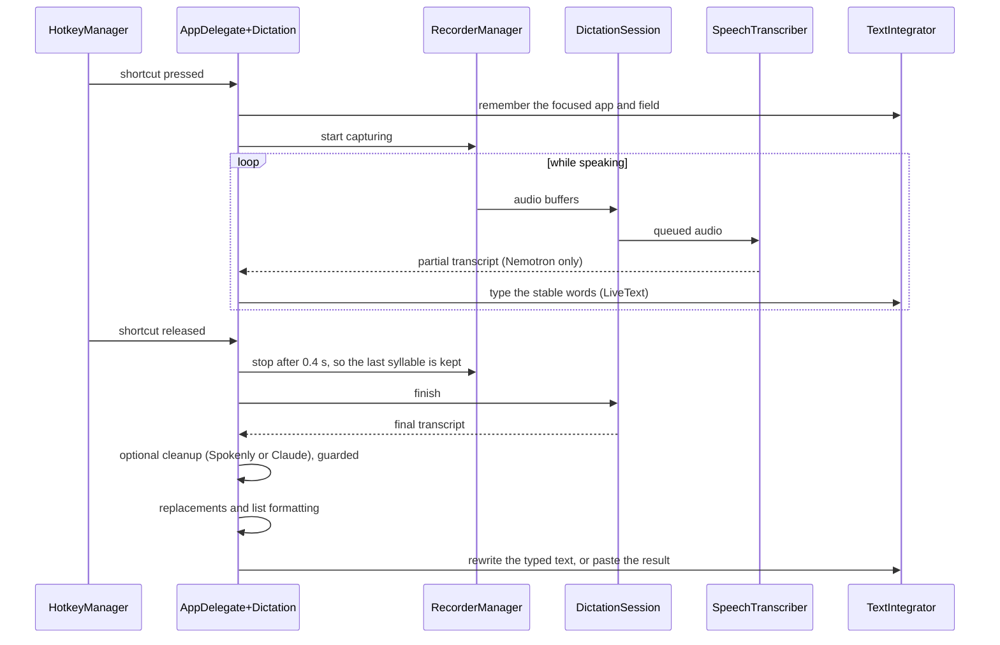

# Architecture

DictateLocal is a single SwiftPM package with three targets:

| Target | Kind | Contents |
| --- | --- | --- |
| `DictateCore` | library | Everything that does not need AppKit: speech models, dictation sessions, text cleanup and the guards that check model output. Covered by `Tests/DictateCoreTests`. |
| `DictateLocal` | executable | The menu bar app: shortcut, microphone, text insertion, HUD and settings. |
| `DictateBench` | executable | A maintainer tool that streams recordings through the models and benchmarks the cleanup. Not shipped. |

`scripts/build-app.sh` wraps the `DictateLocal` binary into `dist/DictateLocal.app` with an `Info.plist`, the icon, the MLX shaders and the license files, and signs it.

## One dictation

### Recognition

`SpeechTranscriber` is the only interface the app uses for speech, with two implementations in `SpeechTranscriber.swift`: `NemotronTranscriber` streams in 2.08 s windows and reports partial text, `ParakeetUltraTranscriber` decodes the whole recording once at the end. `SpeechModel` lists the models, knows where they are stored and downloads them without loading them. `AppDelegate+Models` keeps exactly one transcriber in memory and switches by unloading the old one first; an unloaded transcriber never loads again.

`DictationSession` connects one recording to the transcriber. It queues audio, so speech captured while the model is still loading is not lost, and it waits for the previous session to finish, so a canceled dictation cannot leak into the next.

### Live typing

While Nemotron streams, `LiveText.stablePrefix` holds back the last word, which may still change, and `LiveText.edit` turns the difference between what is typed and what should be typed into deletions and insertions. `TextIntegrator` sends them as keystrokes with `CGEvent` and checks before every few events that the target app and field are still the ones the dictation started in; otherwise it stops typing so keystrokes never land elsewhere.

Chromium-based browsers only expose their text fields through Accessibility after being asked to. `TextIntegrator` sets `AXManualAccessibility` or `AXEnhancedUserInterface` and retries for up to three seconds, then types the text so far.

### Finishing

After release, the final transcript goes through these steps in `AppDelegate+Dictation`:

1. **Cleanup** (optional, one of two):
   - `SpokenlyCleanup`, an MLX model on the Mac. `CleanupGuard` only accepts output that drops filler words and stutters; anything else falls back to the transcript.
   - `ClaudeCleanup`, a request to Claude Haiku with the user's key and prompt. `ClaudeCleanup.accepts` rejects answers whose length shows they are a reply rather than a cleanup. Claude also formats lists.
2. **`TextCleanup`** removes hesitation sounds and applies the user's replacements. It is deterministic and cannot invent text.
3. **`ListFormatter`** turns explicit enumerations into lists, unless Claude already did, or the target is a single-line field.

If the text was typed live, `TextIntegrator.whenRewritable` verifies that the field still contains exactly what was typed before replacing it; otherwise the typed text stays. Text with line breaks is pasted, because typed line breaks would send chat messages. Pasting uses a lazy pasteboard item, so the user's clipboard is restored right after.

## Settings and storage

| What | Where |
| --- | --- |
| Settings | `UserDefaults` of `com.luismerk.DictateLocal`. Keys are defined next to their use, for example in `Settings/SettingsView.swift` and `HotkeyManager.swift`. |
| Anthropic API key | `~/Library/Application Support/DictateLocal/anthropic-api-key`, mode 600. Not in the Keychain, because an app without a stable Apple signing identity would trigger a Keychain prompt after every update. |
| Speech models | `~/Library/Application Support/FluidAudio/Models` |
| Spokenly model | `~/Library/Application Support/DictateLocal/Models` |
| Log | `~/Library/Application Support/DictateLocal/performance.log`, exported or cleared under Diagnostics |

The settings window is a SwiftUI `NavigationSplitView`. Each page is an extension of `SettingsView` in its own file. The Model page stacks separate `Form`s, because a grouped form cannot indent its section boxes, and the Improve Text groups are indented under their header.

## Signing and permissions

macOS ties Accessibility, Input Monitoring and Microphone permissions to the app's code signature. An ad-hoc signature changes with every build and loses them; a certificate, even a self-signed one, keeps them. Releases are signed with the project's self-signed "DictateLocal Release" certificate (see [RELEASING.md](RELEASING.md)), and local builds with a "DictateLocal Development" certificate if one exists (see [CONTRIBUTING.md](../CONTRIBUTING.md)). Neither is notarized by Apple, so the first launch of a download needs the user's approval.
